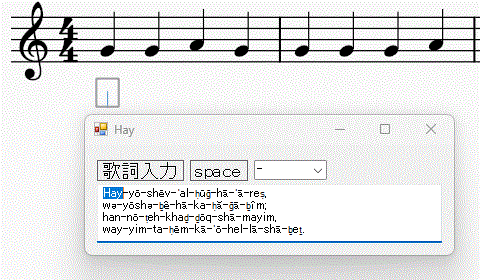

<table>
  <tr>
    <td>
      
    </td>
    </tr>
  <tr>
    <td align="right">
      → <a href="https://github.com/KibeMakoto/books/blob/main/study/Isaiah/Isaiah40-22/Isaiah40-22heb.png">
      Hayyōshēv ʿal-ḥūḡ hāʾāreṣ</a>
    </td>
  </tr>
</table>

開発環境：C# / Windows Forms

機能：[MuseScore Studio](https://musescore.org/download)における歌詞入力補助
